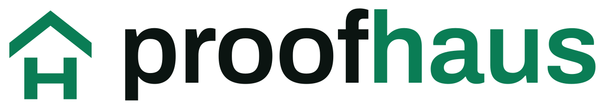

<p align="center">
  <picture>
    <source media="(prefers-color-scheme: dark)" srcset="brand/proofhaus-logo-dark.svg">
    <source media="(prefers-color-scheme: light)" srcset="brand/proofhaus-logo-light.svg">
    
  </picture>
</p>

<p align="center"><a href="https://proofhaus.vercel.app">proofhaus.vercel.app</a> · <a href="https://proofhaus.vercel.app/try">try it</a></p>

**Economic security you run on every deploy.**

Proofhaus forks your protocol into a sandbox, actually attacks it, and reports the
dollars an attacker could extract. Run it locally, gate it in CI, and price cover
against the same number. Auditors read your code and nod. Proofhaus robs you in a
sandbox, tells you it was a real figure, and prices insurance on it.

## What it does

1. Forks a chain into a local sandbox (anvil), one snapshot per attack.
2. Runs a library of economic exploits against the target.
3. Reports a dollar extraction figure, not a severity label.
4. Prices annual cover from that figure and records it on-chain.
5. Exits non-zero over a budget, so it gates a deploy like a test.

## How it works

```
 target ->  fork chain  ->  run attacks  ->  $ extraction  ->  premium
            (anvil)         (4 classes)      (report)          + on-chain
                                                                attestation
                                                                + cover pool
```

- `contracts/` Foundry: attack modules, sample + hardened targets, Attestation, CoverPool
- `engine/` TypeScript: fork runner, attack modules, pricing, attestation writer, CLI, badge
- `app/` Next.js dashboard: live scan, extraction counter, report cards, hardening history, cover market

## The numbers (built-in sample suite)

| Attack class         | Extractable |
|----------------------|-------------|
| sandwich             | $9,352.62   |
| oracle manipulation  | $5,374.82   |
| share inflation      | $100,000.00 |
| reentrancy           | $245,000.00 |
| **total**            | **$359,727.44** |

Full scan runs in about one second. Annual premium on that target: **$135,976.97**
(risk multiplier x1.8). Re-scan the hardened variants and the total, and the
premium, collapse to zero.

## Quickstart

```bash
# contracts
cd contracts && forge test

# engine + scan
pnpm install
cd contracts && forge build           # produce artifacts the engine reads
pnpm -C engine test
pnpm -C engine scan -- --max 0         # exits non-zero: the sample is vulnerable
pnpm -C engine scan -- --hardened --max 0   # exits zero: hardened is clean

# dashboard
pnpm -C app dev                        # http://localhost:3000
```

## Bring your own target

Point Proofhaus at a contract it does not ship. Compile it with Foundry, then either use the dashboard's
YOUR CONTRACT tab (paste or upload the artifact json) or the CLI with a small manifest:

```json
{ "artifact": "contracts/out/MyVault.sol/MyVault.json" }
```

```bash
pnpm -C engine scan -- --target proofhaus.target.json --max 0
```

Proofhaus reads the ABI, detects the shape, deploys the contract into the sandbox, runs the matching attacks
and prices cover. You can force a shape with `"kind": "amm" | "erc4626" | "bank"`, and if nothing matches it
says so instead of guessing.

| shape | detected by | constructor | attacks run |
|-------|-------------|-------------|-------------|
| AMM | `swap`, `getReserves` | `(token0, token1)` | sandwich, oracle manipulation |
| ERC4626 vault | `deposit`, `redeem` | `(asset)` | share inflation |
| ETH bank | `deposit()`, `withdraw()` | none | reentrancy |

The artifact must be a Foundry artifact (`abi` plus `bytecode`). Each new attack class is one module.

## CI gate

`.github/workflows/ci.yml` builds contracts, runs both test suites, and proves the
gate both ways on every push and PR. Point the gate at your own target with a
budget:

```yaml
- run: pnpm -C engine scan -- --max 50000
```

The engine also produces a shields-style badge (endpoint JSON and SVG) so a
`$0 extractable` badge can be pinned to a README.

## Dashboard

```bash
cd contracts && forge build        # the engine reads these artifacts
pnpm -C app dev                    # http://localhost:3000
```

`/` is the landing page and `/try` is the scanner, with three modes: VULNERABLE and HARDENED run the built-in
sample suite, and YOUR CONTRACT scans an artifact you drop in. The cover market panel is a local simulation of
the pool economics; the onchain contracts are the Foundry-tested ones in `contracts/`.

Live scans start anvil, so the scan route needs `pnpm` and `anvil` on the host. Where they are missing, as on a
serverless deploy, the sample suite is served as a clearly labelled replay of a recorded engine run, and
scanning your own contract asks you to run locally. Set `PROOFHAUS_REPLAY=1` to force replay mode, and
`NEXT_PUBLIC_SITE_URL` to your public URL so link previews resolve.

## On-chain market

```bash
cd contracts
cp .env.example .env    # PRIVATE_KEY + testnet RPC urls
set -a; source .env; set +a
forge script script/Deploy.s.sol:Deploy --rpc-url base_sepolia --broadcast --private-key $PRIVATE_KEY
forge script script/Deploy.s.sol:Deploy --rpc-url robinhood --broadcast --private-key $PRIVATE_KEY
# tempo charges far more gas for contract creation than ethereum, so raise foundry's estimate
forge script script/Deploy.s.sol:Deploy --rpc-url tempo --broadcast --private-key $PRIVATE_KEY --gas-estimate-multiplier 1500
# then paste the printed addresses into app/src/app/lib/deployments.ts
```

## Deployments

| chain | contract | address |
|-------|----------|---------|
| Tempo Moderato testnet (42431) | Attestation | [`0xfa820CB11e871eB05334d0f9567F7804c68CdB98`](https://explore.testnet.tempo.xyz/address/0xfa820CB11e871eB05334d0f9567F7804c68CdB98) |
| Tempo Moderato testnet (42431) | CoverPool | [`0xa46c8271C5344a21932ebea331DD8086189986DF`](https://explore.testnet.tempo.xyz/address/0xa46c8271C5344a21932ebea331DD8086189986DF) |
| Tempo Moderato testnet (42431) | phUSD (settlement token) | [`0x3D30B84664E33CE51015a6B310544F45d63aA5D3`](https://explore.testnet.tempo.xyz/address/0x3D30B84664E33CE51015a6B310544F45d63aA5D3) |
| Base Sepolia (84532) | Attestation | [`0xa46c8271C5344a21932ebea331DD8086189986DF`](https://sepolia.basescan.org/address/0xa46c8271C5344a21932ebea331DD8086189986DF) |
| Base Sepolia (84532) | CoverPool | [`0x1Dde2ad21ecf074B3539788C80D6F5caE3F23869`](https://sepolia.basescan.org/address/0x1Dde2ad21ecf074B3539788C80D6F5caE3F23869) |
| Base Sepolia (84532) | phUSD (settlement token) | [`0xfa820CB11e871eB05334d0f9567F7804c68CdB98`](https://sepolia.basescan.org/address/0xfa820CB11e871eB05334d0f9567F7804c68CdB98) |
| Robinhood Chain testnet (46630) | Attestation | [`0x8DAf1d94dB0A8e29d487cb8c458178eF080960fA`](https://explorer.testnet.chain.robinhood.com/address/0x8DAf1d94dB0A8e29d487cb8c458178eF080960fA) |
| Robinhood Chain testnet (46630) | CoverPool | [`0x31E3F15ec535Ab2ea8E2475E8939b2B7c4775d01`](https://explorer.testnet.chain.robinhood.com/address/0x31E3F15ec535Ab2ea8E2475E8939b2B7c4775d01) |
| Robinhood Chain testnet (46630) | phUSD (settlement token) | [`0x2c12788fA1187fb46097A8BCA84d9DDa7f98f5e1`](https://explorer.testnet.chain.robinhood.com/address/0x2c12788fA1187fb46097A8BCA84d9DDa7f98f5e1) |

## What is real today, and what is next

Real and working: the fork-and-attack engine, four attack classes producing real
extraction figures, the pricing model, the on-chain Attestation and CoverPool, the
CLI gate, the CI pipeline, and the dashboard. The engine runs against its built-in
targets and against bring-your-own AMMs and ERC4626 vaults that implement the
standard interfaces (see above).

Next: intake for already-deployed contracts via fork mode, and for non-standard
contract shapes. The hard part, turning an exploit into a priced number, already
works.
